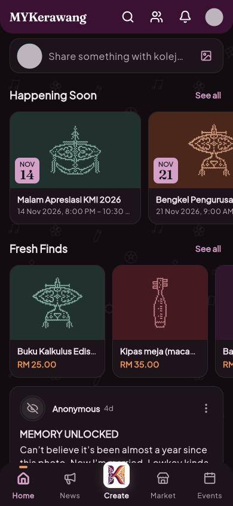
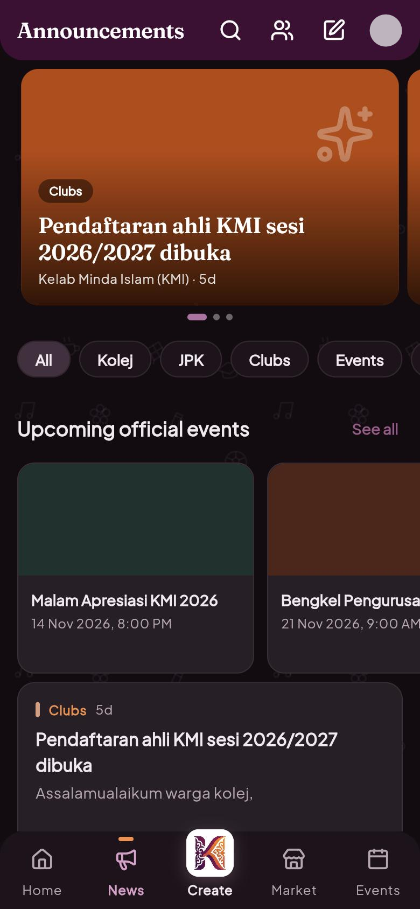
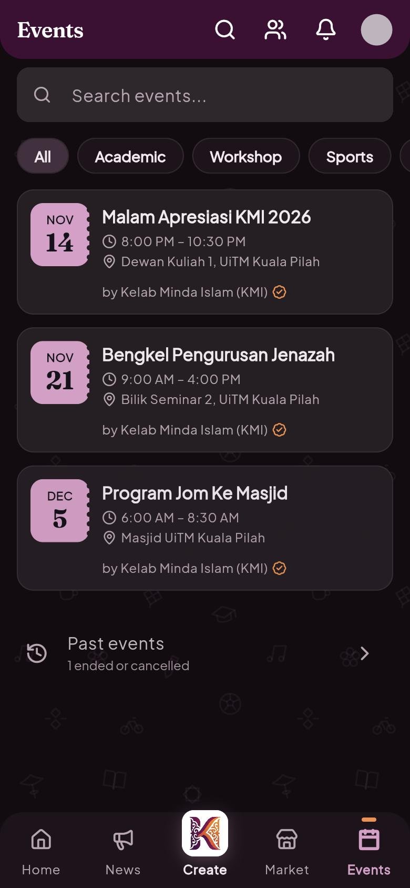

# MYKerawang

A community app for the students, clubs and staff of Kolej Kerawang, a UiTM residential college. One place for the college feed, official announcements, clubs, events and a student marketplace, in English and Malay.

**Live: [kerawang.my](https://kerawang.my)** · version 1.10.2

| Home feed | Announcements | Events |
| :---: | :---: | :---: |
|  |  |  |

## Features

- **Home feed**: posts, questions, confessions and lost & found, optionally anonymous, with tags, `@mentions`, and events or listings shared as cards.
- **Announcements hub**: official news in Kolej, JPK and Clubs channels, with a featured carousel and upcoming official events.
- **Clubs**: a directory, club pages with posts and a public roster, club registration against a registry, join requests, and posting as a club.
- **Events**: event pages with a registration link, QR check-in with a rotating code and a live attendance count, add-to-calendar, and attendance CSV export.
- **KI forms**: per-event survey builder for the HEP report (KI1–KI7 before/after, S1/S2/S3 analysis, copyable tables and CSV).
- **Marketplace**: list items for sale and contact the seller on WhatsApp.
- **Guest mode**: shared links to posts, profiles, events and listings open read-only without an account; any action leads to sign-in and back.
- **English and Malay**, switchable in Settings.
- **Student verification**: students submit a UiTM email and an admin checks it.
- **Moderation console** (`/admin`, PIN-locked): reports and cases, club approvals, join requests, appeals, restrictions, an action log, categories and verifications.

Sign in with email or Google.

## Tech stack

- **Flutter** (Dart `^3.8.1`), shipped as a web app (wasm build). State with `flutter_bloc`, routing with `go_router` and clean URLs.
- **Supabase**: Postgres with row-level security, server-side RPCs for anything privileged (club decisions, form submission, check-in), Auth, Storage and Realtime.
- **Firebase Hosting** serves the built site.

## For developers

### Run locally

```bash
flutter pub get
flutter run -d chrome
```

The app connects to the Supabase project configured in `lib/main.dart` (the public URL and publishable key), so a local run reads and writes real data.

### Tests

```bash
flutter test
```

The database migrations have their own suites under `supabase/tests/`. They apply every migration to an in-memory Postgres ([PGlite](https://pglite.dev)) and check RLS and the RPCs. Install PGlite once, then run a suite:

```bash
cd supabase/tests/moderation
npm i --no-save @electric-sql/pglite@0.2.17
node moderation_test.mjs ../../../
node ../clubs/clubs_test.mjs ../../..
```

The header comment of each `*_test.mjs` file shows how to run it.

### Database

Migrations live in `supabase/migrations/`, one timestamped SQL file per change. `supabase/checks/` holds read-only verification queries and `supabase/seed/` holds beta seed data.

### Deploy

Always deploy with `deploy_web.bat`. Never deploy a plain `flutter build web`. The script stamps a build id, turns off the PWA service worker, swaps in a self-removing worker for old caches, and then runs `firebase deploy --only hosting`.

## Project structure

```
lib/
├── main.dart            entry point, Supabase init, app-wide cubits
├── router.dart          route table (go_router)
├── screens/             feed, market, events, profile, create/edit, settings
│   ├── announcements/   announcements hub
│   ├── clubs/           directory, club page, register, manage
│   ├── events/          check-in, attendance, KI form editor/answers/analysis
│   ├── admin/           moderation console
│   └── verification/    student verification sheet
├── services/            Supabase-facing services (posts, clubs, forms, moderation…)
├── widgets/             shared UI (post card, composer, sidebar, brand…)
├── utils/               rules and helpers (validation, CSV, links, layout)
├── l10n/                English and Malay strings
└── theme/               themes, tokens, icons
supabase/
├── migrations/          schema, RLS and RPCs
├── tests/               PGlite migration suites
├── checks/  seed/
test/                    Flutter widget and unit tests
docs/                    design notes, handover, security review, screenshots
deploy_web.bat           build + deploy to Firebase Hosting
```

## Author

Built by Afas for Kolej Kerawang, UiTM.
